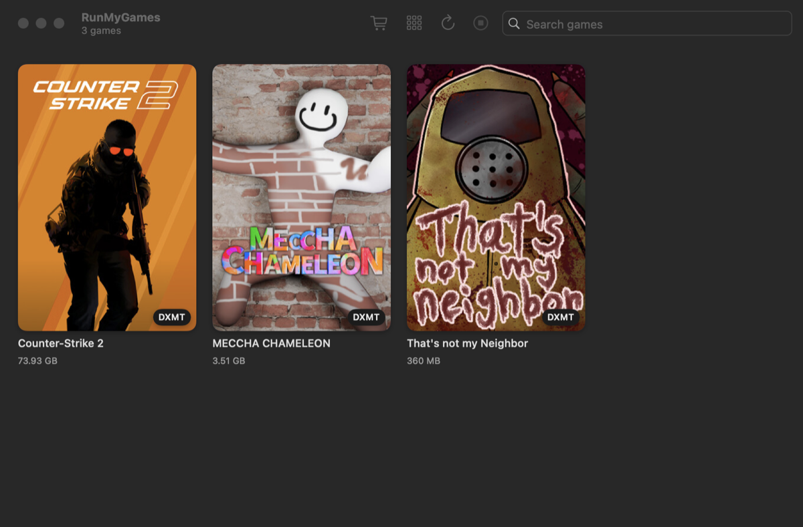

# RunMyGames

Play your **Windows Steam games on an Apple silicon Mac**, for free. RunMyGames is built from the same
open-source pieces CrossOver ships, plus the glue that makes them feel like a Mac app: one-click launch from
Launchpad, the right graphics layer picked for each game automatically, and Game Mode.



## Install

```sh
curl -fsSL https://raw.githubusercontent.com/Rani367/runmygames/main/install.sh | bash
```

This installs **RunMyGames.app** into Applications, the `rmg` command, and the game engine (about 100 MB),
then opens the app. Its setup screen installs Steam into a private Windows environment. Sign in to Steam,
install games, and press **Play**.

Requirements: a Mac with Apple silicon (M1 or newer), macOS 14 Sonoma or newer, and about 3 GB of free space
plus room for your games. The installer sets up Rosetta 2 if it's missing. You don't need Xcode or Homebrew.

> **Why a script and not a download?** RunMyGames isn't notarized by Apple, which costs $99 a year.
> Browsers mark downloads so that macOS blocks un-notarized apps, but `curl` doesn't, so the script just
> works, and it verifies every file's SHA-256 checksum. If you downloaded the `.zip` from the Releases page
> instead, open it once from **System Settings → Privacy & Security → Open Anyway**.

To update, run the same command again, or click **Update** when the app says a new version is out.

## How it works

| Layer | What | License |
|---|---|---|
| Windows compatibility | Wine from **CodeWeavers' CrossOver 26.3** [open-source release](https://media.codeweavers.com/pub/crossover/source/), with msync, the Mac driver and D3DMetal hooks | LGPL |
| DirectX 10/11 → Metal | [DXMT](https://github.com/3Shain/dxmt) | LGPL |
| DirectX 11/12 → Metal | Apple **D3DMetal** from the Game Porting Toolkit (*optional*; you import it, see below) | Apple |
| DirectX ≤ 9, OpenGL | WineD3D | LGPL |
| Vulkan → Metal | [MoltenVK](https://github.com/KhronosGroup/MoltenVK) | Apache 2 |
| Glue | RunMyGames.app, `rmg`, `rmgshim.exe` | MIT |

```
Launchpad icon ──> rmg launch <appid> ──> Steam.exe -silent -applaunch <appid>
                                              │  (launch option added by RunMyGames)
                                              ▼
                       C:\rmg\rmgshim.exe %command%
                       reads C:\rmg\games\<appid>.env (graphics layer, HUD, MetalFX…)
                                              │
                                              ▼
                       game.exe  ──>  DXMT | D3DMetal | WineD3D  ──>  Metal
```

- **Automatic graphics layer per game.** RunMyGames scans the game's executable and engine DLLs to see which
  DirectX/Vulkan/OpenGL it uses, including engines that load their renderer at runtime (Source 2, Godot).
  It then picks D3DMetal, DXMT or WineD3D to match. The [compatibility list](compat/games.json) can override
  that choice, and so can you. If the automatic choice crashes within seconds, the next launch tries another
  layer, and each layer is only tried once.
- **One-click launch.** **Add to Launchpad** gives every game its own app in `~/Applications/RunMyGames` with
  its real artwork. Clicking it starts Steam silently, launches the game, and closes Steam again after you quit,
  even if the game started through its own launcher.
- **Mac-native behavior.** Games run inside a "RunMyGames Engine" app marked as a game, so **Game Mode** turns
  on and controllers work. Option works as Alt, and fonts are smoothed.
- **Per-game tweaks.** Metal performance HUD, MetalFX upscaling (DLSS → MetalFX), Retina resolution, launch
  arguments and environment variables.

Switching the graphics layer per game takes one small Wine patch
([`engine/patches/0001-winedllpath-prepend.patch`](engine/patches/0001-winedllpath-prepend.patch)). It lets a
layer's `d3d11.dll`/`dxgi.dll`/`d3d12.dll` take priority over Wine's own, for that game only.

### DirectX 12 games (optional, recommended)

Apple's D3DMetal runs DirectX 12 games, but its license doesn't allow redistributing it, so you import it once:

1. Download the **Game Porting Toolkit** from <https://developer.apple.com/games/game-porting-toolkit/>.
   It's free with an Apple Account.
2. In RunMyGames, click **Import D3DMetal…** on the setup screen and choose the `.dmg`, or run
   `rmg d3dmetal ~/Downloads/Game_Porting_Toolkit_3.0.dmg`.

Without it, DirectX 12 games that also support DirectX 11 run on DXMT in their DirectX 11 mode.

## Everyday use

Everything works from the app. The `rmg` command does the same things from Terminal:

```sh
rmg games                       # installed games and the graphics layer each one uses
rmg launch 1091500              # play (or click its Launchpad icon, or double-click it in the app)
rmg set 1091500                 # show a game's settings
rmg set 1091500 hud=on metalfx=on
rmg set 292030 renderer=d3dmetal args="-skipintro"
rmg config retina=on idle=120   # global settings (`rmg config` shows them)
rmg launchers                   # add every installed game to Launchpad
rmg doctor                      # health check
rmg kill                        # force-quit Steam and all games
rmg wine winecfg                # run anything inside the Windows environment
rmg help                        # everything else
```

| Where | What |
|---|---|
| `~/Library/Application Support/RunMyGames/` | engine, graphics layers, the Windows environment (`prefix/drive_c`…), settings |
| `~/Library/Logs/RunMyGames/` | Steam, setup and launch logs |
| `prefix/drive_c/rmg/logs/shim.log` | how each game was started |
| `~/Applications/RunMyGames/` | the Launchpad apps for your games |

## Troubleshooting

- **Start with `rmg doctor`** (or the setup screen), which checks every piece.
- **A game doesn't start.** Open the game's settings (right-click → **Game Settings…**) and try another
  **Graphics** option. DirectX 12 games need D3DMetal (see above). `shim.log` shows the exact command used.
- **A game I just installed starts without my settings.** Steam only reads launch options when it starts, so
  the first launch of a newly installed game restarts Steam once. Launching it from RunMyGames does that
  automatically.
- **The Steam window is black.** Steam's own browser UI renders in software under Wine. RunMyGames handles this
  with a small wrapper around `steamwebhelper.exe` and reapplies it after Steam updates. If the window is still
  black, quit Steam with `rmg kill` and open it again.
- **Online games with anti-cheat** (EasyAntiCheat or BattlEye in protected mode, Vanguard, Ricochet…) don't
  run. That's the same with CrossOver and on every Wine-based setup.
- **Something else.** Use **Help → Report a Bug…** in the app, which copies a diagnostics report
  (`rmg diagnose`) to paste into the issue. It contains no account names or passwords.

## Uninstall

```sh
rmg uninstall          # removes the app, the rmg command and the Launchpad apps
rmg uninstall --all    # …and also Steam, your installed games and the engine
```

## Limits

- Kernel-level anti-cheat doesn't work under Wine (see above).
- Rosetta 2 is required, because Windows games are Intel code. Apple has said Rosetta stays available for
  games after macOS 27.
- RunMyGames runs the Windows version of Steam. Native Mac games are better played in the Mac Steam client.

## Development

```sh
brew install mingw-w64 shellcheck
make app      # build/RunMyGames.app
make test     # unit tests
make lint     # warnings as errors, shellcheck, shim and compat checks
make install SKIP_ENGINE=1
```

See [CONTRIBUTING.md](CONTRIBUTING.md) for the layout, how to add a game to the compatibility list, and how
releases (including the engine) are made.

## License

RunMyGames' own code is [MIT](LICENSE). The engine it installs is LGPL and built from public sources. See
[THIRD_PARTY_NOTICES.md](THIRD_PARTY_NOTICES.md) for every component, its license and its source. RunMyGames
isn't affiliated with Valve, CodeWeavers or Apple. Steam is a trademark of Valve Corporation, and CrossOver is a
trademark of CodeWeavers.
